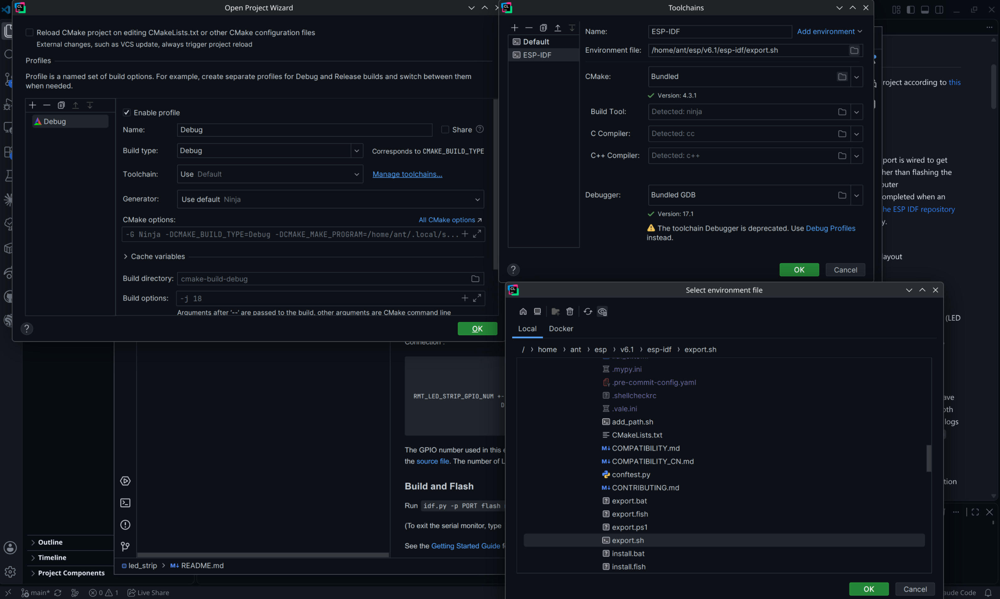
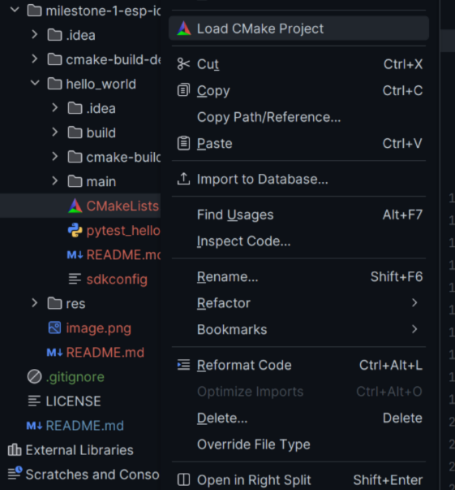
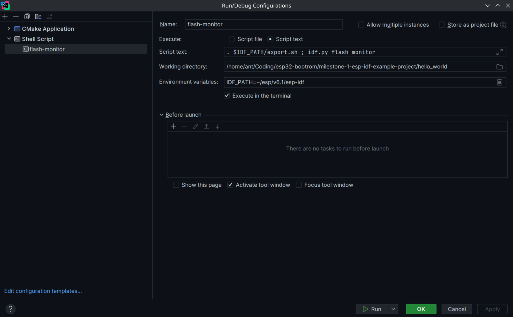

# Milestone 1: Toolchain Configuration & Example Project Setup

## Abstract

This directory contains information about the information process and its potential pitfalls. I use Arch Linux and CLion, so if you're using something more stable, you'll probably not run into the same issues that I did.

## Installation

I installed EIM by following the Arch Linux installation guide on Espressif's website, then installed ESP IDF through the CLI by running `eim install -p ~/esp`, since the default installation location wanted to be in `.espressif/`. There isn't anything wrong with that, but I preferred it in a nonhidden directory.

Next, I got the CLion functionality working by following the [CLion install guide](developer.espressif.com/blog/clion/#configuring-an-esp-idf-project). Unfortunately, the installation instructions assumes macOS, which I'm unfamiliar with, so I had to do a bit of trial-and-error to get an example project to run on my system. I would recommend using `examples/get-started/hello_world` instead of the LED strip example that's used in the blog post, since I don't believe there's an easy-access LED GPIO on this board.

I've included the `hello_world` directory here, if you'd like to use that instead of navigating around in the ESP IDF directories, but both should work similarly.

If you installed via the command I used, your ESP-IDF directory is at `~/esp`. I installed v6.1, so the examples directory is at `~/esp/v6.1/esp-idf`.

```bash
ant@asus-arch:~/esp/v6.1/esp-idf$ ls -lrth
total 236K
-rw-r--r--   1 ant ant  15K Oct 17 16:16 CMakeLists.txt
-rw-r--r--   1 ant ant 8.1K Oct 17 16:16 COMPATIBILITY.md
-rw-r--r--   1 ant ant 8.2K Oct 17 16:16 COMPATIBILITY_CN.md
-rw-r--r--   1 ant ant  314 Oct 17 16:16 CONTRIBUTING.md
-rw-r--r--   1 ant ant  37K Oct 17 16:16 Kconfig
-rw-r--r--   1 ant ant  12K Oct 17 16:16 LICENSE
-rw-r--r--   1 ant ant 6.5K Oct 17 16:16 README.md
-rw-r--r--   1 ant ant 6.3K Oct 17 16:16 README_CN.md
-rw-r--r--   1 ant ant 6.6K Oct 17 16:16 ROADMAP.md
-rw-r--r--   1 ant ant 6.2K Oct 17 16:16 ROADMAP_CN.md
-rw-r--r--   1 ant ant  532 Oct 17 16:16 SECURITY.md
-rw-r--r--   1 ant ant 3.7K Oct 17 16:16 SUPPORT_POLICY.md
-rw-r--r--   1 ant ant 3.4K Oct 17 16:16 SUPPORT_POLICY_CN.md
-rw-r--r--   1 ant ant  721 Oct 17 16:16 add_path.sh
drwxr-xr-x 148 ant ant 4.0K Oct 17 16:16 components
-rw-r--r--   1 ant ant  19K Oct 17 16:16 conftest.py
drwxr-xr-x   7 ant ant 4.0K Oct 17 16:16 docs
drwxr-xr-x  22 ant ant 4.0K Oct 17 16:16 examples
-rw-r--r--   1 ant ant 1.8K Oct 17 16:16 export.bat
-rw-r--r--   1 ant ant  673 Oct 17 16:16 export.fish
-rw-r--r--   1 ant ant  575 Oct 17 16:16 export.ps1
-rw-r--r--   1 ant ant 2.0K Oct 17 16:16 export.sh
-rw-r--r--   1 ant ant 2.2K Oct 17 16:16 install.bat
-rwxr-xr-x   1 ant ant 1.1K Oct 17 16:16 install.fish
-rw-r--r--   1 ant ant 1.5K Oct 17 16:16 install.ps1
-rwxr-xr-x   1 ant ant 1.1K Oct 17 16:16 install.sh
-rw-r--r--   1 ant ant 6.8K Oct 17 16:16 pytest.ini
-rw-r--r--   1 ant ant 1.5K Oct 17 16:16 ruff.toml
-rw-r--r--   1 ant ant 2.0K Oct 17 16:16 sdkconfig.rename
-rw-r--r--   1 ant ant   32 Oct 17 16:16 sgconfig.yml
-rw-r--r--   1 ant ant  530 Oct 17 16:16 sonar-project.properties
drwxr-xr-x  27 ant ant 4.0K Oct 17 16:16 tools
```

Notice `export.sh` above. That's what you're looking for when setting up your toolchain.


The blog post neglects to mention that you need to run `install.sh` before you can use `export.sh`, so open up a terminal and run that install script. You might need to restart CLion to get it to take the updated configuration, though I was able to simply reset the CMake cache and build it.

When setting up your CMake settings, pass `-DIDF_TARGET=esp32s3` for the board used in this project.

When flashing you might get a "permission denied" error for your serial character device drivers. This happens since your user is most likely not part of the `uucp` or `dialout` groups, which control access to `/dev/ttyS*`, `/dev/ttyUSB*`, etc. You can check by running `ls -l` on those files to see who owns them. You'll have to add yourself to the groups with `sudo usermod -aG uucp,dialout $USER` and reboot your system since adding yourself to a usergroup will only apply to login shells.

If you make a configuration for the IDF monitor and you're happy with CLion having the serial output, then you can stop there. Alternatively, you can use something like `picocom` or `minicom` instead. Note that only one process can hold the device at a time, so don't mix both the IDF monitor and another serial monitor unless you want to learn how to use something like `socat` to multiplex the output.

- `picocom -b 115200 /dev/ttyACM0`

When making the configuration for the IDF monitor, it might be a good idea to put `export IDF_PATH=~/esp/v6.1/esp-idf` or similar into your `.bashrc` or `zsh.rc` so that you don't need to export it for every project's setup, though this is just for convenience.

Here's an example of my setup for the monitor, which runs out of this directory. If you decide to run the project from this directory instead of the `hello_world` directory, you'll need to right-click `hello_world/CMakeLists.txt` in CLion's file explorer and click "Load CMake Project".



